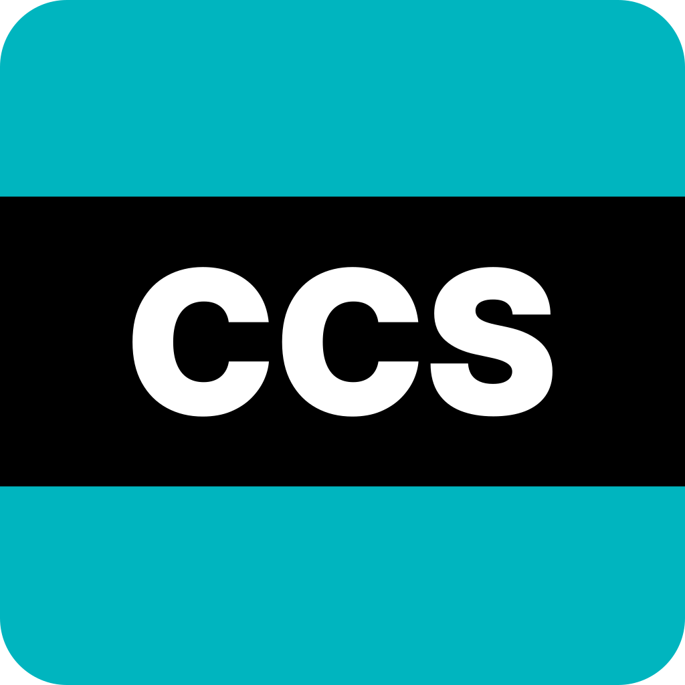

<p align="center">
  
</p>

<h1 align="center">Cyber Cafe Studio</h1>

<p align="center">Made for cyber cafe owners</p>

<h2 align="center">Everything your cyber cafe needs.</h2>

<p align="center">
  Prepare documents, create passport and ID photos, and edit images and PDFs—all in one
  easy-to-use workspace.
</p>

## What you can do

### Documents and photos

- **Doc Stitch:** Arrange and resize images on A4 pages, then export or print documents.
- **Document Scanning & Auto Enhance:** Capture scans from WIA-compatible scanners with quality-prioritized settings and lossless PNG output. Uploaded and scanned document images are automatically denoised, shadow-lifted, contrast-balanced, and sharpened.
- **Document Maker:** Create documents with local autosave and a document library; use built-in templates or save reusable templates; format text, pages, headers, footers, and tables; insert and resize images; use Unicode text and common, Indic-script, installed, or uploaded fonts; import and export DOCX; and preview or export PDFs.
- **Biodata & Resume Maker:** Create a job resume or personal biodata, preview it live, and download a print-ready PDF.
- **Passport Photo Maker:** Create passport and ID photo sheets with configurable sizes and print layouts.
- **Background Remover:** Remove or replace the background in a portrait.

### Image tools

- **Photo & Signature Resizer:** Resize photos and signatures to dimensions needed for online forms.
- **Image Cropper:** Crop, straighten, and frame photos or scanned documents.
- **Image Compressor:** Reduce image file size.
- **Image Converter:** Convert images between supported file formats.

### PDF tools

- **Merge PDF:** Combine PDF files in a chosen order.
- **Split PDF:** Save page ranges from a PDF as separate files.
- **Organize PDF Pages:** Reorder PDF pages.
- **Delete PDF Pages:** Remove selected pages.
- **Image to PDF:** Put selected images into a PDF.
- **PDF to Image:** Export PDF pages as high-resolution PNG images.
- **Compress PDF:** Reduce file size by rasterizing pages; text will no longer be selectable.
- **Rotate PDF:** Rotate PDF pages.
- **Crop PDF:** Set an equal crop margin on all four sides.
- **Add PDF Page Numbers:** Add page and total-page numbers.
- **Add PDF Watermark:** Stamp custom text across PDF pages.
- **Remove PDF Watermark:** Remove watermark annotations, find matching selectable watermark text, or cover a selected flattened-watermark area. Text-match and selected-area cleanup rasterize every page and cannot restore content hidden beneath the mark.
- **Protect PDF:** Encrypt a PDF with an opening password.
- **Unlock PDF:** Remove a PDF password when authorized; AES-128 files are exported as flattened pages.

## Get started

Install [Node.js](https://nodejs.org/) and npm, then install the dependencies:

```powershell
npm ci
```

Start the desktop app:

```powershell
npm start
```

To run the app in a browser during development:

```powershell
npm run dev
```

## Scripts

| Command | Description |
| --- | --- |
| `npm start` | Start the Vite development server and Electron app |
| `npm run dev` | Start the Vite development server |
| `npm run build` | Build the web app into `dist/` |
| `npm run electron:build` | Build and package a Windows x64 installer |
| `npm run typecheck` | Run the TypeScript check |
| `npm run lint` | Run ESLint |
| `npm test` | Run the Vitest test suite |

## Built with

React, TypeScript, Vite, and Electron.
