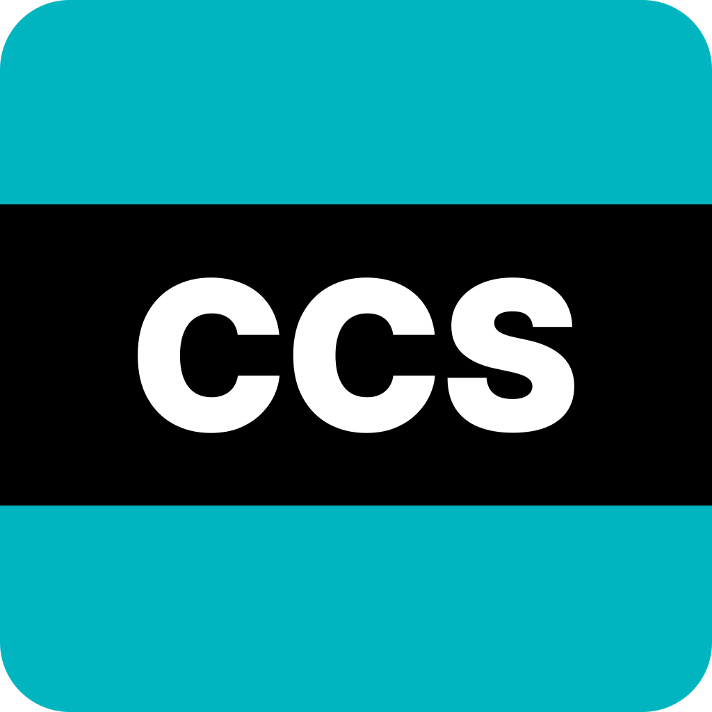

<p align="center">
  
</p>

<h1 align="center">Cyber Cafe Studio</h1>

<p align="center">Made for cyber cafe owners</p>

<h2 align="center">Everything your cyber cafe needs.</h2>

<p align="center">
  Prepare documents, create passport and ID photos, and edit images and PDFs—all in one
  easy-to-use workspace.
</p>

## What you can do

- **Doc Stitch:** Arrange and resize images on A4 pages, then export or print documents.
- **Document Maker:** Create and recover documents with local autosave and a document library; use formal-letter, application, résumé, invoice, and meeting-note templates; edit page size, orientation, margins, page breaks, headers, footers, and page numbers; find and replace; insert links, colored/highlighted text, freely position and proportionally resize images, and add tables; import/export DOCX and preview/export selectable-text PDFs. English, Bangla, and Hindi typing support, installed fonts, and saved font uploads are also available.
- **Biodata & Resume Maker:** Quickly enter a job seeker's contact details, objective, education, experience, and skills, or prepare personal biodata for any purpose with an editable title and flexible personal, education, work, family, and additional-detail sections; preview changes live and download a print-ready PDF.
- **Passport Photo Maker:** Create passport and ID photo sheets with configurable sizes and print layouts.
- **Photo + Signature / Name & Date:** Add a signature image or print a name and date below a photo, then download the combined PNG.
- **Image tools:** Resize, crop, compress, and convert photos and signatures. Each operation opens in its own focused workspace from the home screen.
- **PDF tools:** Merge and split PDFs, organize or delete pages, convert images to PDF or PDF pages to images, compress, rotate, crop, add page numbers, and add text or PNG/JPEG watermarks with configurable position, size, rotation, opacity, color, and page selection. Remove PDF watermark annotations and Cyber Cafe Studio watermarks, search for selectable watermark text, or manually select a flattened watermark area. Text-match and manual cleanup rasterize every page and cannot restore content hidden beneath the mark. Each operation opens in its own focused workspace from the home screen.
- **Background Remover:** Remove portrait backgrounds and choose a replacement.

## Get started

Install [Node.js](https://nodejs.org/) and npm, then install the dependencies:

```powershell
npm ci
```

Start the desktop app:

```powershell
npm start
```

To run the app in a browser during development:

```powershell
npm run dev
```

## Scripts

| Command | Description |
| --- | --- |
| `npm start` | Start the Vite development server and Electron app |
| `npm run dev` | Start the Vite development server |
| `npm run build` | Build the web app into `dist/` |
| `npm run electron:build` | Build and package a Windows x64 installer |
| `npm run typecheck` | Run the TypeScript check |
| `npm run lint` | Run ESLint |
| `npm test` | Run the Vitest test suite |

## Built with

React, TypeScript, Vite, and Electron.
